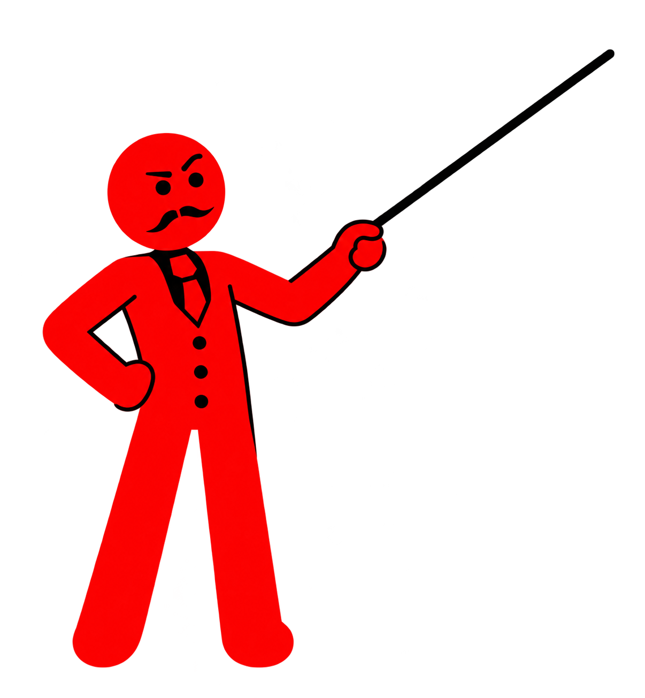
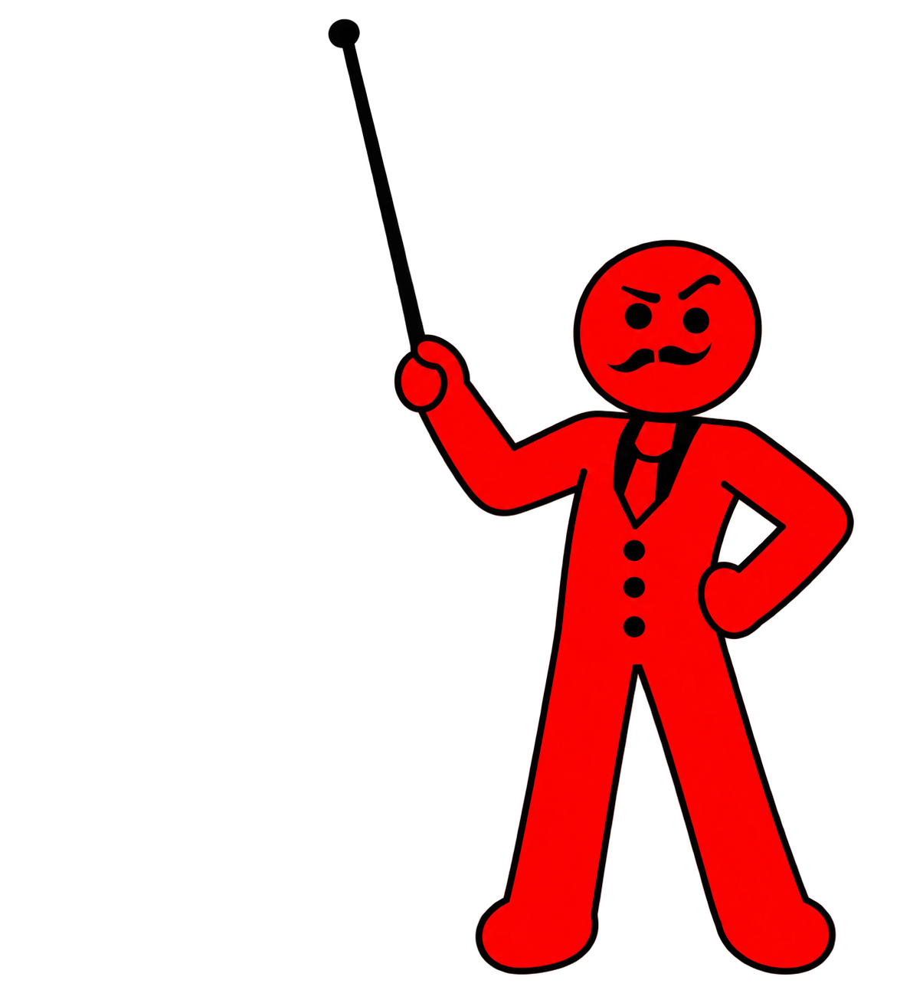
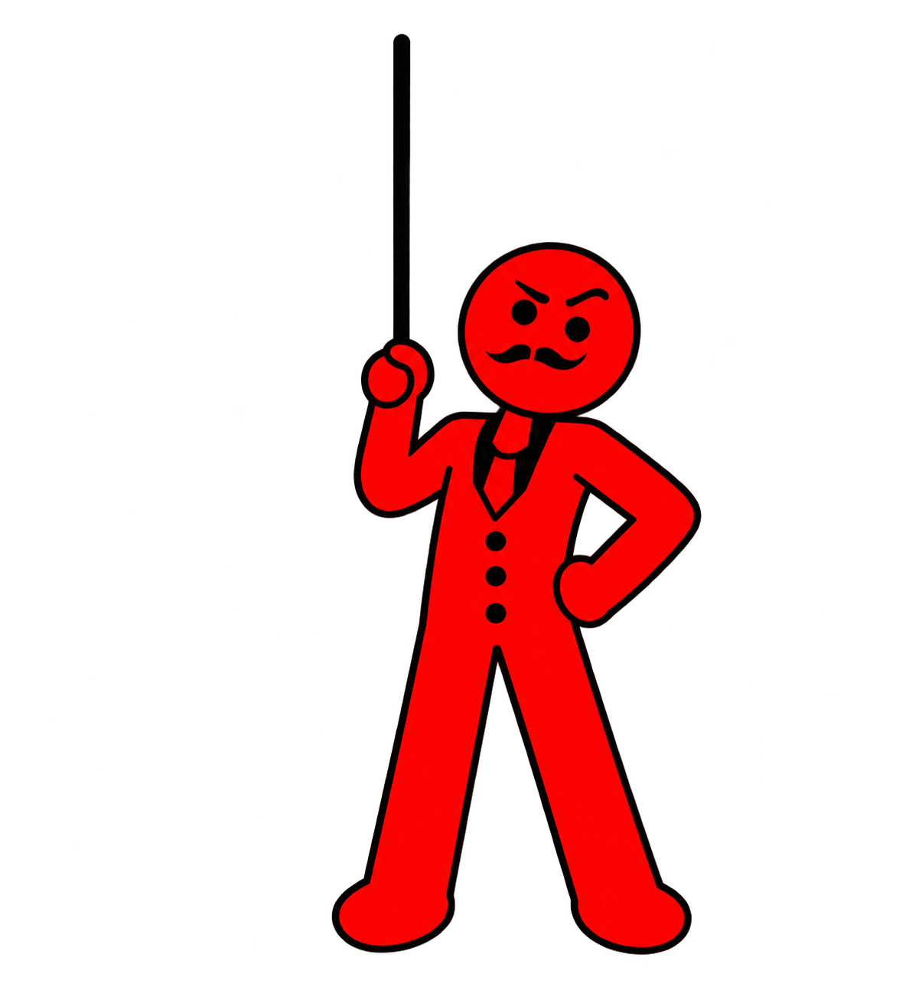

# Instructor guide — approved poses and use

Read full workflow section 20. These are the actual transparent production illustrations, not sketches to imitate loosely. Inspect them on white; black outlines/canes disappear against a black preview. Preserve red/black identity, moustache, camera-facing expressive eyes, coherent hands and bold line weight.

| Pose | Use | Source cane tip (natural pixels) |
| --- | --- | --- |
| 01-diagonal.png | Left/right explanations with a conventional diagonal cane; flip deliberately where needed | (1144, 96) |
| 02-upward.png | Large lower-corner presenter under an upper object | (449, 43) |
| 03-straight-head-tilt.png | Vertical cane, grip beside face, modest gap and head tilted away | (525, 52) |

Coordinates are production anchors for these exact PNGs, not for future regenerated poses. Fit using actual alpha bounds; update coordinates after an asset edit. See Project 6 build.py and audit-pointing.mjs for transforms and measured alignment. Preserve the natural aspect ratio. The measured target must correspond to an actual feature of the object, not just be a convenient number.

## Choreography checklist

1. Main explanation arrives first; presenter follows shortly after.
2. Presenter/cane composited above art, with visible grip and accurate tip contact.
3. New explained item starts entering → presenter immediately retargets in roughly .28 s → firm hold.
4. Move/scale between high and low targets; vary sides. Use substantial but readable lower-corner crops when useful.
5. Clear spacing: no incidental silhouette contact, hidden props, redundant tiny objects or labels behind a face.
6. Review in real time with narration and effects, plus check held frames and transitions. Intentional pointing contact differs from clutter.

## Final scene examples

The MP4 in Project 6 is authoritative for timing. These frames illustrate spacing/scale; an isolated frame cannot show a movement's fluidity.

- [Insulin on right / presenter left](references/instructor/scene-examples/20-4.jpg)
- [Bloodstream and cropped lower-right presenter](references/instructor/scene-examples/22-3.jpg)
- [Large tank / separate fat cluster](references/instructor/scene-examples/53-5.jpg)
- [Mitochondrion / larger ATP](references/instructor/scene-examples/55-8.jpg)
- [Stress response left / cortisol above straight-cane presenter](references/instructor/scene-examples/72-6.jpg)
- [Raised brain and neural-tissue stack](references/instructor/scene-examples/81-4.jpg)
- [Large cytokine / presenter](references/instructor/scene-examples/116-9.jpg)

Do not mechanically reuse one pose in every scene. A small presenter may fit a detailed gut explanation, while another scene needs a much larger cropped figure. Keep the current narrated object dominant. Hand-held/body-contact props can stay combined with a character when the grip must remain coherent.
