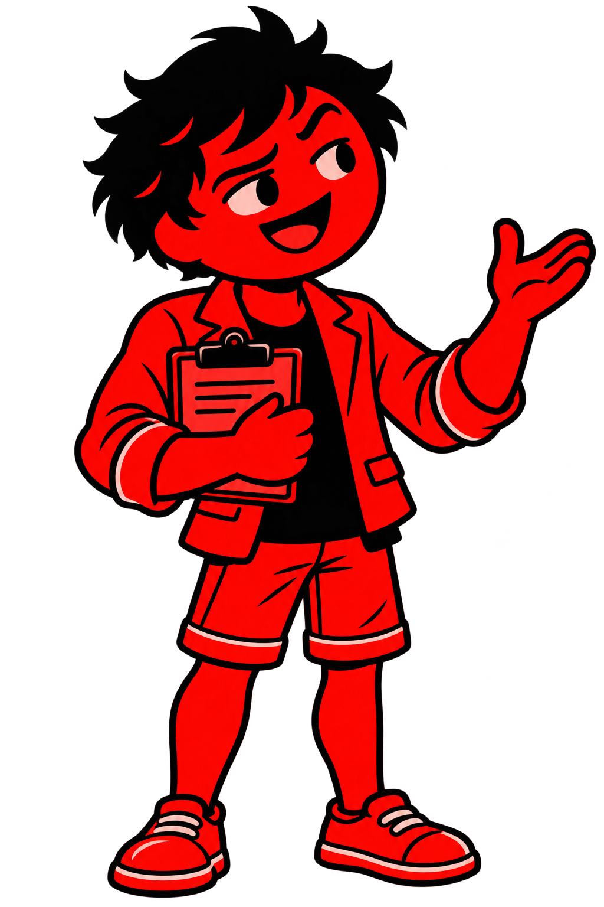
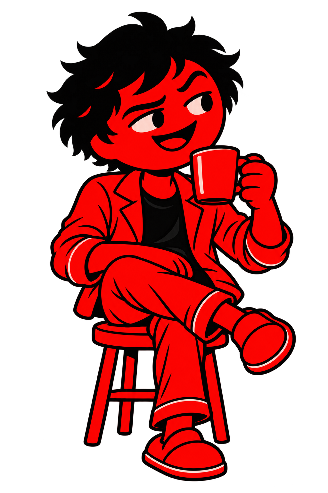

# Current style references — approved 2 November 2026

Read the entire [workflow](workflow.md), especially sections 27–31. This is the current style-selection guide. Earlier visual-reference material remains preserved for acting, motion and provenance; conflicting older appearance defaults yield to this approval.

## Ordinary characters: A and D

Use flat 2D red/black artwork, bold rounded outlines, expressive eyes/mouths and moderately sturdy rounded bodies. **Keep the underlying body shape, composition and proportions consistent. Hair and clothing can vary by scene; ordinary characters may be hairless, and normal stickman illustrations are also allowed. In a two-character scene, use one hairless and one haired figure for distinction unless the brief calls for a different pairing.** A/D establish the visual family, not a mandatory hairstyle or outfit. Keep stylized cartoon proportions. Avoid glossy bodies and realistic human rendering. Attach these actual files, not just their names, during character generation. Use the two approved images; an optional third must be compatible and must not override their appearance.

### A — standing / explaining

Source: Brainwave-Besties-Project.zip, Brainwave-Besties/assets/graphics/science-host.png. Use for proportions, hair, outfit, expression and explaining gesture. The clipboard and pose are examples, not mandatory for every new illustration.

### D — seated acting / coherent hand-held prop

Source: Leg-Power-Brain-Insurance-Project.zip, Leg-Power-Brain-Insurance/assets/graphics/casual-watcher.png. Use for seated staging, rounded limbs, expression and coherent mug grip. The mug/stool are not required in unrelated scenes. The user approved A and D only; B and C from the proposal are not included as approved references.

## Anatomy bodies: explicit exception

An anatomy body is a normal stylized stickman with **no hair and no clothing**. Keep it plainly cartoon/nonrealistic: rounded stickman geometry, slightly thick rather than muscular, no realistic human skin/body rendering. Do not attach the ordinary outfit/hair as requirements for anatomy. Keep rounded foot fronts and straight legs where visible. This exception does not turn ordinary clothed characters near a health explanation into anatomy bodies.

## Explanatory props: clearly 3D-looking

Molecules, micronutrients, cells, organs and other explanatory props use visible volume, depth, shading and perspective while retaining the red/black visual language and legible identity. Characters remain flat. Maintain accurate structure and readable labels; use verified structural references when needed. No baked people in cell/micronutrient/bloodstream scenes; retain the specifically approved external heart-holding character exception.

## Future instructor assets

The three existing cane poses remain geometry/choreography references. A future task can generate the corresponding poses in the approved A/D family. No new instructor images have been generated for this update. Every future pose needs newly measured cane-tip and grip geometry.

## Provenance

The two PNGs are unchanged extracted project assets; hashes and source Library IDs are recorded in [style provenance](references/style/PROVENANCE.json). The [five-project study](Five-Project-Motion-Study.md) maps motion references separately from character approval. Reference art guides new script-specific illustrations rather than replacing the workflow's originality requirements.
